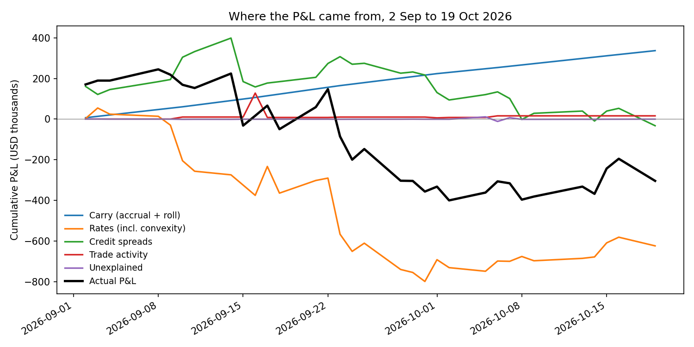
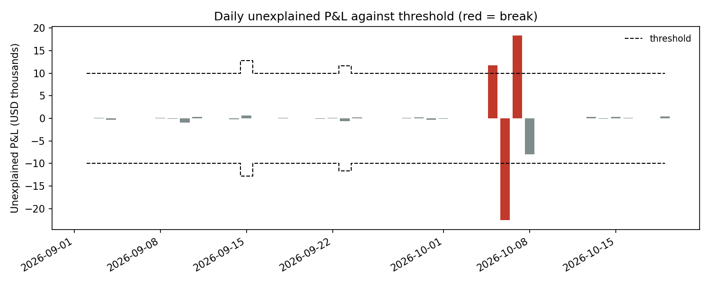

# Daily P&L attribution for a credit bond book

This project runs the daily process a product controller runs for a credit trading desk. For each day it
produces the official P&L for a book of US corporate bonds and Treasury hedges, explains it from the book's
risk, and runs the controls that catch bad marks and bad bookings. It covers 32 trading days, 2 September
to 19 October 2026, on the US Treasury's published daily yield curves.



## Results

The book lost $304.1k over the period. Treasury yields rose sharply (the 10-year went from 4.79% to 5.29%
by the September quarter-end and ended at 5.15%), and the book is only partly hedged: a 1bp rise in yields
cost it $14.2k at the start of the period.

| Driver | September | 2 Sep to 19 Oct |
| --- | ---: | ---: |
| Accrual (coupon interest earned) | +$193.9k | +$299.1k |
| Roll-down and pull to par | +$22.4k | +$37.7k |
| Rates (key-rate DV01) | -$803.9k | -$630.0k |
| Convexity | +$4.9k | +$6.1k |
| Credit spreads (CS01) | +$216.8k | -$32.6k |
| New trades (day-one P&L) | +$129.9k | +$133.9k |
| Amendments | -$120.0k | -$120.0k |
| Cancellations | $0 | +$2.0k |
| Unexplained | -$682 | -$255 |
| **Actual P&L** | **-$356.6k** | **-$304.1k** |

* On the 29 days without a control break, the risk explained 99.4% of gross daily P&L. The average
  unexplained amount was $475, and the largest on a normal day was $906, on 10 September, when the 10-year
  rose 12bp. That residual is the second-order effect of large rate and spread moves together.
* The three days that broke the unexplained threshold were all caused by the stale mark described below.
* The book value rolls forward to the cent: opening value plus P&L minus net cash received equals closing
  value for September, for October to date, and for the whole period.

## The three errors and what caught them

I seeded three common operational errors into the data. Each one is caught by a different control.
None of them would show up if you only looked at the total P&L.

| Error | What happened | Caught by |
| --- | --- | --- |
| Keying error | 16 Sep: a $4m purchase of the A-rated utility bond was booked at 92.57 instead of 95.57. This shows a false gain of $117.8k. | Trade review. The price was 2.95 points away from the independent mark, against a 0.75 tolerance. The fix is booked as an amendment on 17 Sep (-$120.0k), leaving the true day-one P&L of -$2.2k. |
| Duplicate booking | 1 Oct: a $10m Treasury hedge sale was booked twice. | Trade review duplicate check (same bond, side, size, price and date). Cancelled on 2 Oct; a test confirms the cancel leaves no P&L behind. |
| Stale price | 5 to 7 Oct: the official mark for the BBB energy 2045 bond stopped updating. | Three controls: the stale price check, IPV (variance of $11.7k and -$10.7k on two days), and the unexplained P&L threshold on all three days. |

When the mark was fixed on 8 October, the catch-up showed as -$8.0k of unexplained P&L. That is below the
threshold, which is why each day's breaks have to be followed until they are fully reversed.



## How it works

**Market data.** Treasury yields are the US Treasury's Daily Par Yield Curve Rates (14 tenors from 1 month
to 30 years). The par yields are bootstrapped into a zero curve; a test checks every par bond reprices to
exactly 100. Credit spreads are simulated with a fixed seed: a common credit factor scaled by rating, plus
issuer-specific noise. Real index spread data from commercial providers cannot be republished.

**Pricing.** Each bond is priced by discounting its remaining cash flows on the Treasury zero curve plus its
own spread. Accrued interest uses 30/360 for corporate bonds and actual/actual for Treasuries. The official
mark is the model price rounded to three decimals, except where a mark issue is seeded.

**Actual P&L** comes from the official marks:
closing value minus opening value, plus cash received in the day (coupons, trade settlements, and
corrections for amended or cancelled trades).

**Explained P&L** is built bottom-up for every position held overnight, using the previous day's risk:

* *accrual*: coupon interest earned;
* *roll-down*: the bond repriced one day later on the same curve, less the accrual;
* *rates*: key-rate DV01 at each of the 14 Treasury tenors, times that tenor's move;
* *convexity*: half the gamma, times the square of the DV01-weighted move;
* *credit*: CS01 times the spread change, plus the second-order term.

Trade activity is explained separately. New trades contribute day-one P&L (end-of-day mark minus trade
price), amendments contribute their cash correction, and cancellations reverse the trade.

**Controls**, run every day:

1. *Unexplained P&L*: break if it exceeds the larger of $10k and 5% of the day's P&L.
2. *New, Amends and Cancels review*: every event listed with its P&L effect. New trades are flagged if
   priced outside the tolerance (0.25 points for Treasuries, 0.75 for investment grade, 1.50 for high
   yield), or if they look like duplicates.
3. *Stale prices*: the official mark did not move while the independent price moved more than 0.02.
4. *IPV*: official mark against the independent price, in dollars on the position, with a $10k tolerance.
5. *Book value roll-forward*, for September and for the full period.

The daily report also writes one line of commentary per day, naming the two largest drivers and the market
move behind each. For example, on 15 Sep: "-$256.2k: credit -$214.0k (BBB +6.1bp, BB +12.2bp); rates
-$50.4k (10y +3bp)".

## Simplifications

* Credit spreads are simulated, so the credit P&L shows how the method works, not what a real book earned.
* Trades settle on trade date, and coupon dates are not moved for weekends or holidays.
* There is no funding cost, repo or FX. All bonds are US dollar, fixed-coupon and without call options.
* The blotter is synthetic. Trade prices were set relative to the independent mark: dealer purchases from
  clients below mid and sales above it.
* Key-rate risk uses the 14 published Treasury tenors with linear interpolation between them. Treasury's
  own curve uses a monotone convex spline.

## Running it

```
pip install -r requirements.txt
python run.py          # writes the reports and charts to output/
python -m pytest       # 15 tests
```

| Output | Contents |
| --- | --- |
| `daily_pnl_explain.csv` | Daily P&L by driver, unexplained P&L, threshold, market moves and commentary |
| `position_pnl_explain.csv` | The same split for each bond, each day, with DV01 and CS01 |
| `trade_review_nac.csv` | Every New, Amend and Cancel with its P&L effect and flags |
| `control_exceptions.csv` | All control breaks in one list |
| `reconciliation.csv` | Book value roll-forward by period |
| `summary.md` | Results, exceptions and the full daily commentary |

The code is in `src/pnlexplain`: `curves.py` (bootstrapping), `bonds.py` (cash flows, accrued interest,
pricing), `market.py` (data and spreads), `book.py` (trade events and positions), `pnl.py` (actual and
explained P&L), `controls.py` and `report.py`. The Treasury data is in `data/treasury_par_yields.csv`,
taken from home.treasury.gov.
